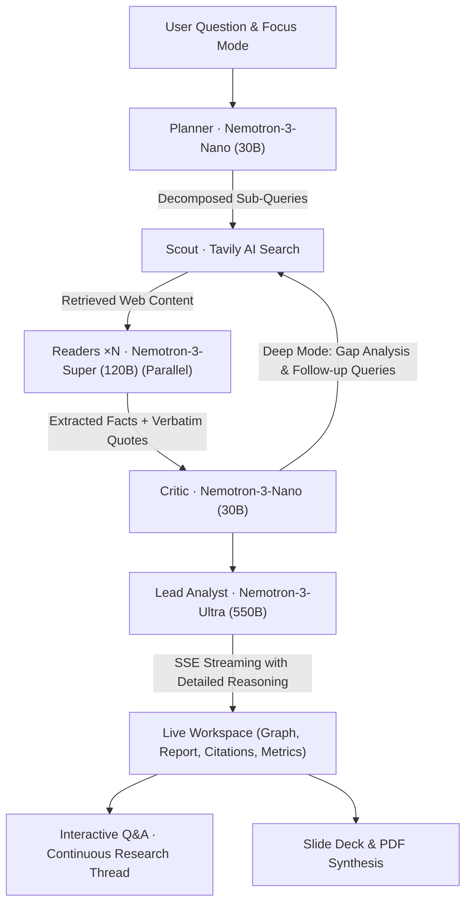

# 🛩️ NemoSearch: Autonomous Multi-Agent Deep Research on NVIDIA Nemotron

> **Nebius × NVIDIA Global AI Hackathon · Track: Best Apps and Agents**  
> *Targeting Grand Prize ($20,000) and Best Use of Tavily ($3,000)*
>
> An enterprise-grade, Perplexity-style deep research engine powered by a specialized 3-tier **NVIDIA Nemotron 3** ensemble hosted on **Nebius Token Factory**, orchestrated with **Tavily AI Search**.

---

## ⚡ Highlights & Perplexity-Grade Capabilities

1. **Focus Modes**: Target your research across 4 dedicated domains:
   - 🌐 **All Web**: Broad multi-angle general intelligence.
   - 🎓 **Academic & ArXiv**: Curated for peer-reviewed preprints, arXiv, PubMed, and Nature.
   - 📈 **Finance & SEC**: Tailored for SEC filings, earnings transcripts, Bloomberg, and market forecasts.
   - 📰 **Recent News**: Real-time breaking developments within the last 7 days.
2. **Hover-to-Verify Citations**: Hovering over any citation tag (`[1]`, `[2]`) renders an instant verification card displaying the **source domain, relevance score, and verbatim quote** directly extracted by the Reader agent.
3. **Interactive Multi-Turn Thread Memory**: Have a continuous conversation with your research brief. Ask follow-up questions; Nemotron Nano assesses if new web retrieval is needed, and Nemotron Ultra reasons over the combined context.
4. **Executive Slide Deck Generator**: One-click synthesis of an executive 5-slide presentation outline with key takeaways, generated live from the research brief.
5. **Executive PDF Export**: Styled print-ready executive briefing sheets.
6. **"Right Model for the Right Task" Telemetry**: Live dashboard demonstrating token and latency efficiency across the 3 specialized Nemotron tiers.

---

## 🧠 Multi-Agent Architecture



### Specialized Model Routing:
| Role | Model on Nebius Token Factory | Core Responsibility |
|---|---|---|
| 🧭 **Planner** | `nvidia/NVIDIA-Nemotron-3-Nano-30B-A3B` | High-speed query decomposition & search strategy |
| 🛰️ **Scout** | `Tavily Search API` | Real-time web retrieval with domain filtering & news topics |
| 📖 **Readers ×N** | `nvidia/nemotron-3-super-120b-a12b` | Parallel evidence parsing & verbatim quote extraction |
| 🧪 **Critic** | `nvidia/NVIDIA-Nemotron-3-Nano-30B-A3B` | Coverage auditing and recursive gap analysis |
| ✍️ **Writer** | `nvidia/Nemotron-3-Ultra-550b-a55b` | Complex reasoning (`detailed thinking on`) and cited Markdown briefing |

---

## 🚀 Quick Start

### 1. Setup Virtual Environment
```powershell
python -m venv .venv
.\.venv\Scripts\python -m pip install -r backend\requirements.txt
```

### 2. Configure Environment Keys
Create your `.env` file (see `.env.example`):
```env
# Nebius Token Factory (get key at https://tokenfactory.nebius.com)
NEBIUS_API_KEY=your_nebius_api_key
NEBIUS_BASE_URL=https://api.tokenfactory.nebius.com/v1/

# Tavily AI Search (get key at https://tavily.com)
TAVILY_API_KEY=your_tavily_api_key

# NVIDIA Nemotron 3 Models
MODEL_NANO=nvidia/NVIDIA-Nemotron-3-Nano-30B-A3B
MODEL_SUPER=nvidia/nemotron-3-super-120b-a12b
MODEL_ULTRA=nvidia/Nemotron-3-Ultra-550b-a55b
```

### 3. Launch Application
```powershell
cd backend
..\.venv\Scripts\python -m uvicorn app.main:app --port 8000
```
Open **[http://localhost:8000](http://localhost:8000)** in your browser.

---

## 📋 Evaluation Criteria Mapping

- **Technical Execution**: Full async streaming architecture via Server-Sent Events (SSE), parallel Reader agents governed by an async semaphore, robust JSON extraction from reasoning models, and seamless chat-template kwargs handling for `enable_thinking`.
- **Use of Nemotron**: True ensemble leveraging three Nemotron-3 model scales (Nano 30B, Super 120B, Ultra 550B), demonstrating why multi-tier routing beats monolithic LLM calls in both speed and cost.
- **Use of Tavily**: Advanced search depth with domain filtering for Academic and Finance focus modes, plus real-time news extraction.
- **Impact & UX**: Closes the gap between automated research and human decision-making with verifiable citation hovercards, slide outlines, and continuous conversational follow-ups.
